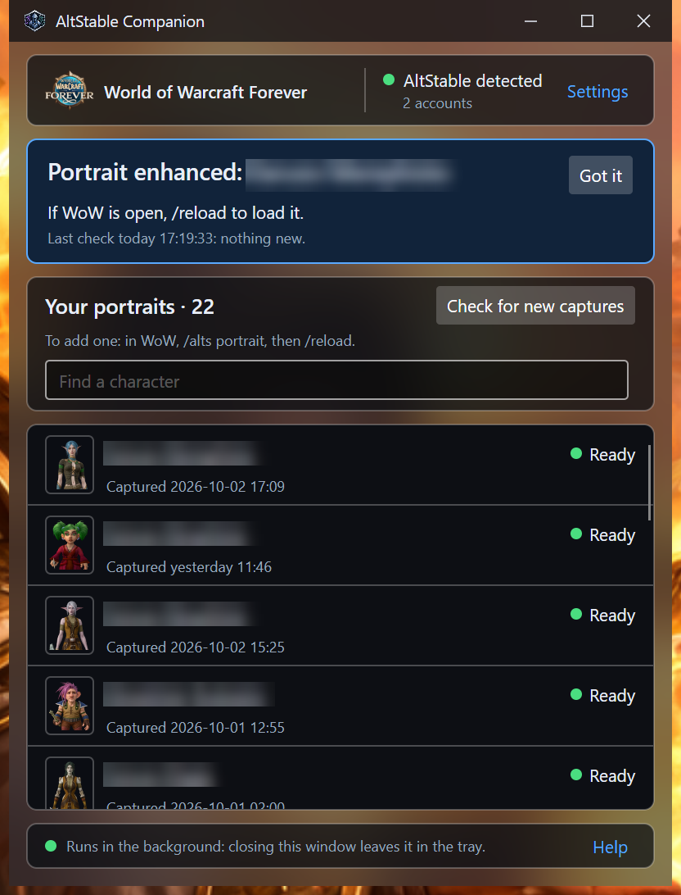
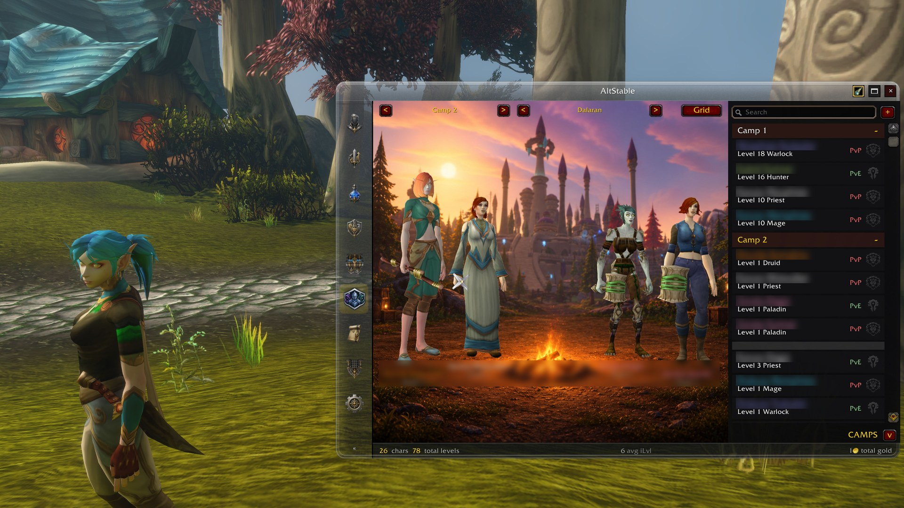
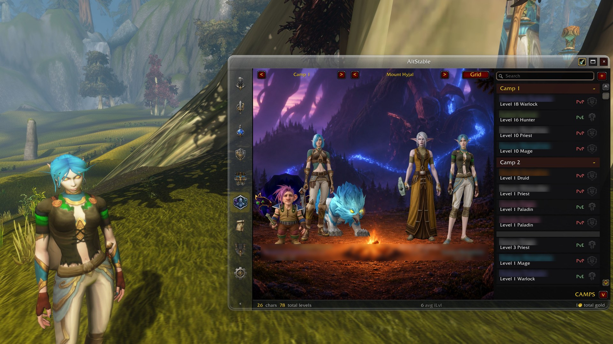

# AltStable Companion

A free Windows app for players of the [AltStable](https://github.com/Spotnick2/AltStable)
addon for World of Warcraft: Forever. It turns the portraits you capture in the game into
the cutouts the addon's Roster scene draws your characters with.

**Three pieces, and only the first is required:**

| Piece | What it is | Do you need it? |
|---|---|---|
| **AltStable** (the addon) | Tracks and compares your characters in the game | Yes. It is useful on its own |
| **AltStable Companion** (this app) | Turns your `/alts portrait` captures into Roster portraits | Only for portraits in the Roster |
| **Portraits from the armory** (a setting in this app) | Takes each character's picture from Blizzard's armory website, with no capture | No: the app asks you once |
| **Enhanced portraits** (a setting in this app) | Asks the Codex CLI on your PC for a nicer picture of each portrait | No: off by default, and it uses your ChatGPT account's usage |

## Install

1. Have the AltStable addon installed, from [CurseForge](https://www.curseforge.com/wow/addons/altstable). The captures come from it, and the portraits go
   back to it.
2. From the [releases page](https://github.com/Spotnick2/AltStableCompanion/releases),
   download `AltStableCompanion-<version>-win-x64.exe` (the newest one at the top). It is the
   whole app: Windows 10 or 11, 64-bit, nothing else to install (not .NET either). Put it in a
   folder you will keep, such as `Documents\AltStable Companion`, and run it.
3. Windows may show "Windows protected your PC", because the file is not code-signed. If
   it offers **More info → Run anyway**, that is the way through. A Windows 11 PC with Smart
   App Control turned on may not offer it; unsigned distribution is a limitation of this free
   tool for now.
4. The window opens near the tray. Read its first-start card, then press **Start watching**.
   The card says what will be converted, and that the two screenshots a portrait is made from
   are deleted afterwards unless you tick the box to keep them.

The app finds your game folder by itself. **Settings** shows which one it chose; use
**Browse...** if that is not the game you play AltStable in.

## Your first portrait

1. In the game, on the character you want, type `/alts portrait` (or press the spyglass
   button on AltStable's title bar). The interface hides for about three seconds while two
   screenshots are taken.
2. Accept the **reload** the addon offers, or type `/reload`. The capture is only saved
   to disk on a reload or logout, and that is when this app sees it.
3. Within seconds the app writes the portrait and says so.
4. **The very first time only: quit the game completely and start it again.** WoW only
   discovers a new addon folder (`AltStableCutouts`, which the app creates) when it starts.
   A `/reload` is not enough for that first one; the app's window says so too.

From then on, every new portrait shows after a `/reload`. Capture again whenever your
character's look changes; the spyglass button glows when a new portrait is due.

A portrait is the character exactly as the game draws it when you capture. With the client's
SD (classic) character models switched on, your portraits will most likely come out in SD too.
Switch HD models back on before `/alts portrait` if you want HD portraits.

The app has to be running to make portraits. It does not start with Windows: run it
again after you log in to Windows. Captures taken while it was closed are converted the
next time it starts, unless automatic processing is off.

## Portraits from the armory (optional)

Blizzard's armory website draws each of your characters of level 10 or more. The app can
use that picture as the character's portrait. A character you never captured gets one too,
and a portrait follows your gear without a new capture. The first time it starts (or the
first time after the update that brings this), the app asks whether to use it. Settings can
change your answer.

- **What leaves your PC.** For each character of level 10 or more that is not hidden, a
  request for its picture to Blizzard's picture server, `render.worldofwarcraft.com`. The
  address names the character by the number in its GUID. No account, password or key is
  sent, and none is needed.
- **When.** Once each time the app starts, then every hour from 6 to 24 hours after you
  played a character: the armory draws it again about 7 hours after you log off. One
  request at a time, a second apart. A picture that has not changed is not downloaded again.
- **Which picture shows.** A capture is sharper than the armory's picture and may have an
  enhanced picture, so it stays the portrait for as long as it shows the character as they
  are. Once the character changes gear, or their look at the barber, the armory picture
  takes over as soon as it is newer than the capture (its date minus 7 hours), even if it
  does not show the latest change yet: the next one will. A capture always shows
  at once: capture with `/alts portrait` whenever you want the new look now. A capture made
  before AltStable recorded the gear (or one whose record is gone) falls back to the date
  alone.
- **HD or SD.** Settings picks the armory's HD model or its SD (classic) one.
- **No capture prompt after a gear change.** For a character the armory has drawn, the
  spyglass button no longer glows after a gear change: the armory picture shows the new gear
  on its own. A character it has not drawn yet is still asked for a capture. This needs
  AltStable 1.2.0 or later; older versions keep asking.
- **With enhanced portraits.** The armory draws a character again every time you play it,
  and each enhanced picture uses Codex usage, so three settings hold that back:
  - **Enhance new armory pictures on their own** (on by default). Off, each new armory
    picture is offered on the Settings page, and made when you press **Make it now**.
  - **At most every 7 days** per character (1 to 90). Meanwhile the app does not ask the
    armory about that character, and the picture made before stays. If a picture failed, the
    plain armory picture can stay that long too. The character's line says when it resumes,
    to the minute, and **Check now** under it asks the armory at once: the picture that leaves
    is enhanced at once, as you asked for it, past this hold and the daily limit.
  - **At most 5 armory pictures in a day** (any 24 hours), which you can untick.

  A picture drawn again that looks the same (under 1 % of it changed) keeps the enhanced
  picture made from it. A capture is always enhanced at once.
- **US only, for now.** The app reads the region from the game's `Config.wtf`.
- **Your own Blizzard API client (optional).** Nothing above needs one. With one, the app
  also asks Blizzard's profile API about each character that is not hidden, at any level:
  once when it starts, then every 6 hours. It learns each character's level and when it last
  logged in, on any PC. So a character this PC last saw at level 9 is drawn once it reaches
  10 elsewhere, and a login on another PC starts the hours after play too.
  - To get one, sign in at [develop.battle.net](https://develop.battle.net/access/clients),
    create a client with any name (no redirect URL is needed), and paste its ID and secret
    under Settings. **Test** asks Battle.net for a token with it; **Remove** forgets it.
  - It is kept encrypted for your Windows user (`blizzard-client.bin` in the app's folder)
    and never shown again, written to the log or put in diagnostics. Copied to another
    Windows user, it cannot be read: enter it again there.
  - What leaves your PC with it: the client ID and secret to `oauth.battle.net`, for a token;
    then, for each character, a request to `us.api.blizzard.com` that names it.
  - If Battle.net refuses the client, the app says so and carries on without it.

The pictures go to `Interface\AddOns\AltStableCutouts\Cutouts\Armory`. A capture's portrait
stays in its own file, so a capture is never lost to an armory picture.

## Enhanced portraits (optional)

*Enhanced portraits in the Roster. The plain ones, above, are what every portrait looks like
without this setting.*

Off unless you turn it on, in Settings. It needs the [Codex CLI](https://github.com/openai/codex)
on this PC: `npm install -g @openai/codex`, then `codex login` with a ChatGPT account. The
app runs that command line and nothing else. The pictures come from the CLI's built-in
image tool, on the ChatGPT account it is signed in to, and the app has no say over that
tool's quality. No OpenAI API key is used, needed or read.

**What it spends.** With it on, the app asks Codex for a picture of each character of the
chosen level or more that has a portrait and is not hidden. When you first turn it on, that
includes **all of your existing portraits**: ticking the box first says how many pictures it
will make at once, and nothing is sent until you confirm. Each attempt uses Codex usage on
your account, whether or not a picture comes back.

**What leaves your PC.** The portrait's cropped image and the character's race, gender
and class, plus any instructions your Codex CLI is configured with, go to the account Codex
is signed in to.

**When it makes a picture.** Only for a character who has none yet, or whose portrait
was captured again.
- If only the style, the model, the effort or the app's wording changed (an update may
  change the wording), the pictures already made stay. The Settings page says how many
  could be remade and offers to make them again. A settings change is never a decision to
  spend.
- A picture that was refused or failed is not tried again for the same combination.
- An attempt that was cancelled (the box unticked, the app quit) is tried once more.

**Turning it off** stops new attempts and cancels the one running. Pictures already made
stay, and the addon keeps drawing them. The addon's Roster must be new enough to know
enhanced pictures; the Settings page says so when yours is not.

**Going back to the plain portrait for one character:**
1. With the app running (and automatic processing on), delete
   `Interface\AddOns\AltStableCutouts\Cutouts\Enhanced\<name>.tga`. The **Open Cutouts
   folder** button under Help takes you there.
2. Within a minute the app rewrites the list of portraits the game reads. To make it
   immediate, choose **Check for new captures** in the tray menu.
3. `/reload` in the game.

That picture is not made again until you capture that character again or change the
style. Codex keeps its own copy of every picture in its `generated_images` folder; the app
reads it and never cleans it.

## Updates

**Help → About** says which version this is. **Check for updates** asks GitHub for the
list of this project's releases; that one request is all that leaves the PC.
- Nothing is downloaded until you press **Update now**. The new file is checked against
  the release's `SHA256SUMS` before it is used.
- **Restart now** puts it in place of the running file (same path, same name, so your
  shortcut keeps working) and starts it. If that fails, the version you had starts again
  and the log says why.
- A beta is offered betas and releases; a release is offered only releases.
- The Settings box **Check for updates when the window opens** (off by default) runs the
  check by itself, at most once an hour. A download is always your press.

You can also quit the app and run a newer file from the releases page. Starting a second
copy only brings the running one's window forward.

The running file keeps its name: if you kept the release's name
(`AltStableCompanion-1.2.4-win-x64.exe`), it carries an older version in its name than
the one it is. **Help → About** is the authority on what is running.

## What it touches

No network access, except the three things you ask for: portraits from the armory and
enhanced portraits, which you switch on, and the update check.

It touches only:
- the screenshots it matched to a capture, and, when you clean up the character list and
  say yes, those of the characters you clean up;
- the `AltStableCutouts` addon folder;
- its own settings and log in `%APPDATA%\AltStableCompanion`, and there, in `originals`, each
  enhanced portrait as Codex made it, full size (about 2 MB each), and your Blizzard API
  client when you save one;
- a diagnostics file in your Downloads folder, only when you press Help → **Save diagnostics…**;
- for enhanced portraits, Codex's own `generated_images` folder, read only.

It also has a one-time side effect of .NET, not of the app: a single-file app unpacks
the native libraries it carries into `%TEMP%\.net\AltStableCompanion` the first time it
starts.

**Characters AltStable no longer has.** The list follows AltStable's: a character it no
longer has (forgotten, deleted, or left over from a beta) is marked as such and not counted,
and the list offers **Clean up the character list**. It names them and asks before deleting
their files: their portraits, armory and enhanced pictures, the screenshots of their
captures and the copies kept for them. Their capture records in AltStable's saved file stay
(the companion never writes it), and are not listed again. Settings can leave such
characters out of the list without deleting anything.

Closing the window leaves the app running in the tray; **Quit** is in the tray icon's
menu.

## Troubleshooting

- **No portrait after a capture.** Did you reload or log out after `/alts portrait`?
  Is the app running, and not paused (tray menu: **Process new captures automatically**)?
  The window's headline and the list say what happened to each capture.
- **The portrait is written but the game does not show it.** If it is your first one,
  quit the game completely and start it again. Otherwise `/reload`.
- **The app is watching the wrong game.** Left to itself, it picks the game AltStable is
  installed in, and says so on the dashboard when AltStable is in another game too.
  Settings → **Browse...** and choose the game
  folder you play AltStable in (the one with `Interface` and `WTF` inside, such as
  `...\World of Warcraft\_forever_`).
- **Reporting a problem.** Open an [issue](https://github.com/Spotnick2/AltStableCompanion/issues).
  Help → **Save diagnostics…** writes one text file to your Downloads folder to attach: the versions,
  the WoW folder, each character's counts and the end of the log. Your characters' names are
  in it; your account folder names and your Windows user folder are not. Nothing is sent.

## Options

| Option | What it does |
|---|---|
| `--minimized` | Start in the tray, without the window. Handy in a shortcut. |
| `--wow-dir <folder>` | Use this game folder (such as `...\World of Warcraft\_forever_`) for this run, and no other. Browse and Detect again are switched off. |
| `--data-dir <folder>` | Keep the settings, the log and the full-size enhanced portraits in this folder, not in `%APPDATA%\AltStableCompanion`. |

A wrong option, a `--wow-dir` that is not a game folder, or a `--data-dir` it cannot
write to is an error: the app says so and stops. It never carries on with a guess.

Only one copy runs at a time.

## For developers

How it works, how it is built and how it is released:
[`docs/DEVELOPING.md`](docs/DEVELOPING.md).

## Licence

MIT - see [LICENSE](LICENSE).

The World of Warcraft Forever emblem in the window is Blizzard Entertainment's, used
resized and otherwise unchanged under their trademark usage guidelines; the originals and the
terms are in [Reference/Blizzard](Reference/Blizzard/README.md). World of Warcraft is a
trademark or registered trademark of Blizzard Entertainment, Inc., in the U.S. and/or other
countries. This is a fan tool, not affiliated with or endorsed by Blizzard.
